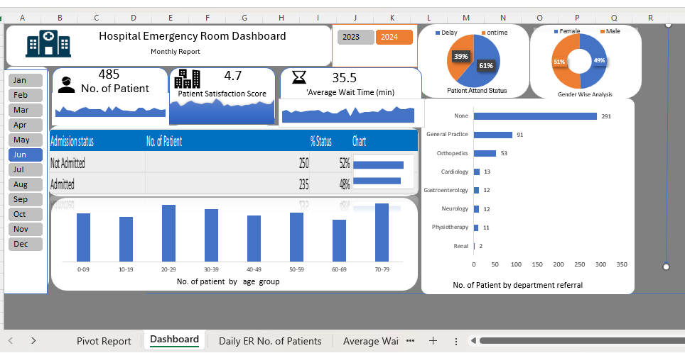

# 🏥 Hospital Emergency Room Dashboard — Excel

My first Excel dashboard project. I wanted to see if I could turn a hospital emergency room dataset into something a manager could read in seconds: how busy the ER is, how long patients wait, how satisfied they are, and where they go next.

> This is a learning project built on a sample dataset. It does not contain real patient information.

## Questions I wanted to answer

- How many patients came to the ER, and how busy was each day?
- How long do patients wait, and how satisfied are they?
- How many patients arrived on time compared with delayed?
- How many patients were admitted?
- Which departments do patients get referred to?
- What does the patient mix look like by age and gender?

## What I found (June 2024 view)

- **485 patients** visited in June, ranging from 10 to 23 per day.
- The **average wait time was about 35.5 minutes**, and the **average satisfaction score was 4.7**.
- **61% of patients (297) were marked as delayed**, against 39% on time (188). Delays are a major issue.
- **About half were admitted**: 235 admitted (48%) and 250 not admitted (52%).
- **60% of patients (291) had no department referral.** Among those who did, **General Practice (91)** and **Orthopedics (53)** led.
- Gender is almost evenly split (239 female, 246 male), and patients are spread fairly evenly across age groups from 0 to 79.

The underlying dataset is larger than one month. The dashboard is filtered to June 2024 using slicers.

## What's in the workbook

| Sheet | What it contains |
|---|---|
| Dashboard | The finished one-page dashboard with KPI cards, charts and month/year slicers |
| Pivot Report | The pivot tables that feed the dashboard |
| Daily ER No. of Patients | Daily patient volume trend |
| Average Wait Time Trend | Daily average wait time |
| Satisfaction Score Trend | Daily average satisfaction score |

## How it's built

- **Data Model (Power Pivot):** the data and a separate calendar table are connected in Excel's data model.
- **Pivot tables and charts:** twelve pivot tables feed the KPIs, charts and sparklines.
- **Slicers:** month and year slicers filter the whole dashboard.
- **Design:** custom icons, rounded cards and a consistent blue and orange palette.

## How to use it

1. Download `hospital_er_dashboard.xlsx` and open it in Microsoft Excel (desktop version).
2. Click **Enable Content** if Excel asks.
3. Click the month buttons to explore the numbers.

**Please don't click Refresh All.** The data is stored inside the file, and refreshing resets the filters and changes the numbers.

## What I'd improve next

- Add a "% delayed" KPI card and a wait time by department view.
- Show more than one month so the slicers are more useful.
- Document units, such as wait time in minutes and the satisfaction scale.

## Tools

Microsoft Excel · Power Pivot · PivotTables · Slicers

## Credit

Grateful to Satish Dhawale (https://lnkd.in/dxYC3M9b) for the KPI-driven dashboard framework that shaped how I approached this build.

## About me

Hi, I'm **Farhana Ashraf Ganaie**, learning data analytics. This project sharpened my ability to turn raw data into clear, actionable business insights, a skill I'm excited to bring into a data analyst role.

Connect with me on [LinkedIn](https://www.linkedin.com/in/farhana-ashraf-ganaie-8b188529b).

Hi, I'm **Farhana Ashraf Ganaie**, learning data analytics. This project sharpened my ability to turn raw data into clear, actionable business insights, a skill I'm excited to bring into a data analyst role.

Connect with me on [LinkedIn](https://www.linkedin.com/in/farhana-ashraf-ganaie-8b188529b).
